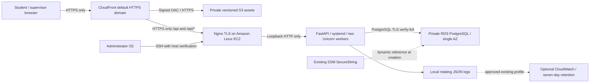

> **Historical architecture proposal.** The current deployment is the existing
> Ubuntu EC2/SQLite server. Follow [the current runbook](aws-deployment.md) and
> [verification report](aws-ec2-verification.md). Account, region, cost and policy
> claims below are dated planning evidence, not current verification or deployment
> authorization. Do not provision a replacement as part of verification.

# Phase 6 proposed architecture ? AWS Free Plan

> **Current decision:** remain on the project Free Plan in us-east-2. Ohio reads/template validation succeeded; previous us-east-1 policy-blocker/Console-IAM prerequisites are superseded. The diagram below is the earlier EC2 proposal. Read [the corrected analysis](aws-project-free-plan-decision.md) for the low-idle-cost alternative and upgrade requirements.

Current target: the new AWS Free account plan, profile campusshift, region us-east-1, $100 credits observed through the current profile's Free Tier API. No application infrastructure is confirmed in this account. Historical Academy/Ubuntu references are separate. See [Stage A evidence, costs and HTTPS choices](aws-stage-a.md) and [secure IAM setup](aws-profile-setup.md). This diagram shows the existing public-HTTPS-origin template proposal, not deployed resources or the unimplemented VPC-origin alternative.



PostgreSQL preserves the application's relational foreign keys, joins, partial unique indexes and Alembic history. DynamoDB would require redesigning persistence and transactional invariants; this phase deliberately does not do that. Application SNS delivery is separate unfinished work; Stage A adds no notification service or delivery integration.

The scheduler remains a pure Python module. Department-local recurring dates/minutes, approved-leave constraints, versioned publication and actual UTC attendance semantics are unchanged. `UTCTimestamp` intentionally remains canonical UTC text on both databases; older `DateTime(timezone=True)` fields become native PostgreSQL timestamptz. PostgreSQL connections set their session timezone to UTC outside a transaction. No personal data is copied from SQLite.

## Feasibility status

Current read-only evidence is in [Stage A](aws-stage-a.md): CLI v2.40.2, campusshift/us-east-1 and STS verified; FREE/ACTIVE plan with $100; current broad AccountFullAccessRole has AdministratorAccess. The account is an organization member and its SCP explicitly denies EC2/network, RDS, SSM and CloudFormation reads. S3/CloudFront/log/quota reads succeeded. No account resources or IAM entities were created/modified by the assistant. Live CloudFormation validation was attempted and denied; local template lint passes.

No additional IAM role can override the SCP. The user confirmed the intended account; ask its authorized organization owner to review the restriction. The full policy could not be read, so the cause is not attributed to the Free Plan. Do not upgrade, detach guardrails or switch regions to evade it. Scoped identity and trusted-origin/no-domain design review remain additional gates. Optional CloudWatch delivery, actual RDS connectivity and public HTTPS have not been verified.

After authorized identity/policy resolution, rerun `scripts/aws_deploy.py --profile campusshift --region us-east-1 preflight` with temporary credentials. It uses only read/list/describe calls and never reads credential files, environment credentials, parameter values, or secret values. Output can contain account/resource identifiers and should stay private. Read successes confirm only those reads. An AccessDenied is a blocker for that operation, not permission to modify IAM or try another account. Use the profile-info helper to redact whole credential rows from internally captured aws configure list; never share raw credential diagnostics or environment dumps.

Optional Stage B authorization probes below require an approved scoped write policy first. They are **not Stage A checks** and were not executed. Read-only preflight and template validation are the current authorized operations:

```bash
aws --version
aws --profile campusshift --region us-east-1 sts get-caller-identity
aws --profile campusshift --region us-east-1 ec2 describe-key-pairs --query 'KeyPairs[].KeyName'
aws --profile campusshift --region us-east-1 ssm get-parameter --name /aws/service/ami-amazon-linux-latest/al2023-ami-kernel-default-x86_64 --query Parameter.Value --output text
aws --profile campusshift --region us-east-1 ec2 run-instances --image-id APPROVED_AMI --instance-type t3.micro --subnet-id EXISTING_PUBLIC_SUBNET --security-group-ids APPROVED_SG --key-name EXISTING_KEY --min-count 1 --max-count 1 --dry-run
aws --profile campusshift --region us-east-1 ec2 create-security-group --group-name campusshift-permission-probe --description permission-probe --vpc-id EXISTING_VPC --dry-run
# Only if an instance profile was explicitly approved for this use:
aws --profile campusshift --region us-east-1 ec2 run-instances --image-id APPROVED_AMI --instance-type t3.micro --subnet-id EXISTING_PUBLIC_SUBNET --security-group-ids APPROVED_SG --iam-instance-profile Name=APPROVED_PROFILE --min-count 1 --max-count 1 --dry-run
aws --profile campusshift --region us-east-1 rds describe-orderable-db-instance-options --engine postgres --db-instance-class db.t3.micro
```

`DryRunOperation` confirms that exact EC2 authorization probe, not future quota/capacity or other services. RDS, S3 and CloudFront do not have equivalent universal create dry runs. Review an unexecuted change set; creation remains unconfirmed until an approved real deployment succeeds. CloudFormation itself being allowed does not bypass underlying permissions. Confirm VPC/subnet IDs belong to the verified new Free Plan account, private DB subnets span two AZs, public subnet has an Internet Gateway route, DNS resolution works, the CloudFront prefix-list rule fits the SG quota, and EBS/RDS encryption is permitted. Region is an explicit CLI argument; do not create a separate `Region` template parameter that disagrees with `AWS::Region`.

## HTTPS and network boundaries

CloudFront rejects public HTTP, forwards API requests with all methods and Authorization/query strings through managed `AllViewerExceptHostHeader`, and disables API/error caching. S3 uses Origin Access Control, encryption, versioning and public-access blocking. A viewer-request function rewrites extensionless SPA routes only; API errors remain JSON/status errors. Browser requests use same-origin `/api`, so production CORS is empty by default. CloudFront adds HSTS, CSP, nosniff, frame denial and no-referrer headers.

The API custom origin requires an operator-controlled DNS name with a publicly trusted matching certificate. A CloudFront viewer certificate alone does not secure the origin. Nginx listens on 443; its cleartext 8000 upstream is loopback only. Origin HTTP is not offered. Deliver certificate/private key over verified SSH, keep private keys root-only, use DNS-based issuance/renewal approved by the domain owner, and reload Nginx after renewal. Do not use `curl -k`, self-signed origin certificates, public HTTP authentication, or an unrestricted origin port as workarounds. Without a trusted origin certificate, stop before public authentication.

Inbound origin 443 is limited to the regional CloudFront IPv4 origin-facing prefix list; SSH to one administrator IPv4 `/32`; PostgreSQL to the backend SG only. There are no public DB ports, NAT Gateways or load balancers. The prefix list admits traffic from **all** CloudFront distributions, not just this distribution. It limits direct network bypass but is not distribution-specific authentication. Backend JWT/role/department checks remain mandatory. Stronger distribution-specific origin authentication is future hardening. Egress TCP 80/443 supports package installation, certificates and updates; DB egress is scoped to its SG. Instance metadata requires IMDSv2. EC2 public IP/DNS mapping can change after stop/start.

## Transactions and data safety

SQLite retains its write reservation. PostgreSQL API mutations acquire one transaction-scoped advisory lock before loading the authenticated ORM user; service validation paths share it. This preserves the application's previous serialized-write assumptions across Uvicorn workers and prevents check-then-insert overlap races. READ COMMITTED statements observe committed data after waiting. The database still enforces FK, unique attendance/shift, one active attendance/student, pending correction and one current publication constraints. Coarse locking limits write throughput and should be replaced with carefully ordered scoped locks for larger deployments. Direct SQL/administrative writers must not mutate a live application's invariants without maintenance coordination.

Production configuration rejects SQLite and weak JWT secrets. PostgreSQL connections use pre-ping and hide SQL parameters in errors. RDS runtime configuration uses libpq `verify-full` with the official CA and a restricted passfile. No passwords appear in DATABASE_URL, process arguments, templates, user-data or logs. Provision a dedicated database-owner application role, rather than using the RDS master login in the running API. RDS master password comes from an existing approved SSM SecureString through a dynamic reference; creating/changing it needs separate approval and KMS/SSM permissions.

## Resource and cost review before approval

See [the current us-east-1 resource/cost inventory](aws-stage-a.md) and `infrastructure/cost-plan.us-east-1.json`. Existing-template baseline is approximately $27.64/month before variable usage/free allowances/credits, with a $30?35 small-demo planning envelope. Selected micro sizes, EC2 Standard credits, explicit PostgreSQL 16 minor, disabled extended-support enrollment and unchanged Single-AZ/storage limits reduce accidental cost. Do not assume legacy twelve-month/750-hour offers apply. Budget alerts must exclude credits to expose gross consumption and do not stop resources.

No billable provisioning, plan upgrade, Organizations or CDK bootstrap occurs in Stage A/B. IAM is no longer inherently read-only, but the Stage A human policy intentionally cannot create infrastructure. Current main templates need no instance profile or CloudFormation execution role. Optional EC2 log-only role/profile configuration is under `infrastructure/iam/` and needs separate IAM/cost review and CAPABILITY_IAM; named IAM resources would require CAPABILITY_NAMED_IAM. CloudFront VPC origins, if selected, need a service-linked role and a reviewed no-NAT private bootstrap/management design; current templates do not implement that alternative.

Resources normally persist across sessions until explicitly changed/deleted or account lifecycle events occur. RDS/S3/log Retain policies protect against routine stack deletion, not credit/time expiry or account closure. Keep protected synthetic-data backups outside the account. Teardown, retained storage and snapshots require explicit review/approval. No account-wide deletion loops are provided.

Sources used for design: [CloudFront origin HTTPS requirements](https://docs.aws.amazon.com/AmazonCloudFront/latest/DeveloperGuide/using-https-cloudfront-to-custom-origin.html), [managed cache policies](https://docs.aws.amazon.com/AmazonCloudFront/latest/DeveloperGuide/using-managed-cache-policies.html), [managed origin-request policies](https://docs.aws.amazon.com/AmazonCloudFront/latest/DeveloperGuide/using-managed-origin-request-policies.html), [SSM secure dynamic references](https://docs.aws.amazon.com/AWSCloudFormation/latest/UserGuide/dynamic-references-ssm-secure-strings.html), [managed prefix-list quotas](https://docs.aws.amazon.com/vpc/latest/userguide/working-with-aws-managed-prefix-lists.html), [Amazon Linux Python versions](https://docs.aws.amazon.com/linux/al2023/ug/python.html).
