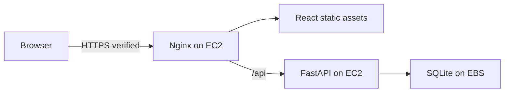

# AWS architecture: existing EC2 application

The selected deployment is one running Linux `t3.micro` in Ohio (`us-east-2`) with a 20 GiB gp3 root disk and public IPv4. Nginx serves the React frontend and proxies `/api` to FastAPI on the same host. Both the frontend and `/api/health` respond successfully. See [live details and costs](aws-current-deployment.md).

There is no active Lambda, API Gateway, RDS/Aurora, S3 or CloudFront deployment. The discarded serverless attempt's private networking, artifact storage, logs and database configuration were removed; its three secrets are marked for deletion without ongoing charges.

The host uses SQLite at `/home/ubuntu/CampusShift/backend/campusshift.db`, a daily online backup timer and encrypted copies on the operator computer. Active release: `phase6e-61652acbf5f2`; see [rollout evidence](production-rollout.md). Local development defaults to SQLite; the repository supports PostgreSQL for future production configuration. Production mode requires PostgreSQL, a strong signing key and HTTPS CORS origins. Do not claim the current host has those settings solely because templates exist.

Backend authorization, transaction handling, migration checks, scheduling and attendance remain application responsibilities. AWS-managed human access uses the `campusshift` profile and the Free Plan. All Regional resources must stay in the selected Region; no plan upgrade or managed-policy modification is authorized.

The monthly resource baseline is about $12.84 before credits, taxes, transfer, snapshots and surplus CPU credits. The instance's Unlimited CPU-credit setting may add charges under sustained CPU load. This is a small demonstration deployment with a single host failure boundary, not a tested high-availability campus production service.

Optional EC2/PostgreSQL/S3 templates and prepared Amazon Linux installers remain in the repository as references. They are not deployed and must not be run against the existing Ubuntu host without inspection and a separately requested change. See [operations runbook](aws-deployment.md).
