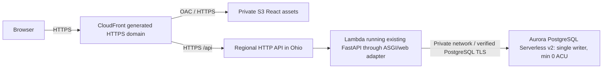

> **Existing deployment takes precedence:** CampusShift is already served from
> the Ohio EC2 endpoint. See [the current runbook](aws-deployment.md) and
> [verification report](aws-ec2-verification.md). This document preserves an
> alternative architecture and historical account observations, not authorization
> to provision or migrate. Current account identity is unverified on this workstation.

# Decision: remain on the project-based Free Plan

> Stage B implementation now prepares the Lambda/Aurora architecture described here. The helper defaults to Ohio and supports the managed project identity. Use the [current serverless runbook](aws-serverless-deployment.md) for implemented templates, current costs, commands and outstanding cloud tests. This memo preserves the earlier research findings and decisions; no cloud provisioning has occurred.

Reviewed November 13, 2026. The user confirmed the project's assigned home region is **US East (Ohio), us-east-2**. Use the existing `campusshift` browser-login profile and select that region explicitly. No AWS resource, IAM/SCP policy, account plan, Advanced Features setting or local profile configuration was changed during this investigation.

**Correction to Stage A:** us-east-1 was a user-selected preference, but this project cannot select an arbitrary regional deployment location. AWS manages the project's organization and human-access roles. The observed managed AccountFullAccessRole is expected in this experience; replacing it with a new Console IAM user or asking the owner to edit the managed SCP is not the appropriate prerequisite. AWS blocks IAM login-profile operations for projects. Preserve the managed roles and use AWS Settings/Builder ID for human access.

The previous us-east-1 denials remain accurate historical observations. Their interpretation as an unresolved organization-policy problem requiring owner intervention is superseded by the documented region restriction and successful home-region rechecks below. The attached private SCP was not retrieved; its observed behavior matches the public managed policy.

## Exact action comparison

AWS's `AllowFreeTierServices` statement is a Deny/NotAction allowlist: matching a listed pattern escapes that specific deny; it is not an unconditional IAM permission grant. Other denies still apply. The regional policy's `UsEast1Partitional` exception list omits EC2 regional describes, RDS, SSM and CloudFormation, while admitting global/partitional reads such as STS, CloudFront and `s3:ListAllMyBuckets`. `RegionFloor` confines ordinary regional work to the selected home region.

| Stage A action(s) | Free Tier exclusion pattern | Result in us-east-1 | Actual read-only recheck in us-east-2 |
| --- | --- | --- | --- |
| ec2:DescribeVpcs | ec2:* | Explicit SCP deny | Succeeded |
| ec2:DescribeSubnets | ec2:* | Explicit SCP deny | Succeeded |
| ec2:DescribeRouteTables | ec2:* | Explicit SCP deny | Succeeded |
| ec2:DescribeInternetGateways | ec2:* | Explicit SCP deny | Succeeded |
| ec2:DescribeKeyPairs | ec2:* | Explicit SCP deny | Succeeded |
| ec2:DescribeInstanceTypes | ec2:* | Explicit SCP deny | Succeeded; t3.micro reported |
| ec2:DescribeInstanceTypeOfferings | ec2:* | Explicit SCP deny | Succeeded |
| ec2:DescribeSecurityGroups | ec2:* | Explicit SCP deny | Succeeded |
| ec2:DescribeManagedPrefixLists | ec2:* | Explicit SCP deny | Succeeded |
| rds:DescribeDBInstances | rds:* | Explicit SCP deny | Succeeded |
| rds:DescribeOrderableDBInstanceOptions | rds:* | Explicit SCP deny | Succeeded; PostgreSQL 16.15/db.t3.micro/gp3 available |
| ssm:GetParameter, ssm:DescribeParameters | ssm:* | Explicit SCP deny | Both succeeded; only public AMI value/private parameter metadata read |
| cloudformation:ListStacks | cloudformation:* | Explicit SCP deny | Succeeded |
| cloudformation:ValidateTemplate | cloudformation:* | Explicit SCP deny | Both current platform/frontend templates validated successfully |
| s3:ListAllMyBuckets | s3:*; also us-east-1 regional exception | Previously succeeded | No bucket creation attempted |
| cloudfront:ListDistributions, cloudfront:ListVpcOrigins | cloudfront:*; also us-east-1 exception | Previously succeeded | No distribution/origin creation attempted |
| lambda:ListFunctions | lambda:* | Not tested previously | Succeeded in Ohio |
| apigateway:GET /apis (HTTP API list) | apigateway:* | Not tested previously | Succeeded in Ohio |

Fresh reads also found the existing default VPC with three public subnets in Ohio. A private database design still needs explicitly planned private subnets/route tables; no network changes were made. Full identifiers/results are in ignored `.local/aws-project-home-region.json`. Successful reads and template validation do not prove every resource create, service-linked-role, quota/capacity or runtime integration will succeed. No create/dry-run-launch was used to claim deployment feasibility beyond the public policy and these reads.

## Project deployment workflow and existing CloudFormation

Use AWS Settings to open the correct project, Builder ID/browser login, its existing managed human role and the project's assigned region. AWS manages the organization; there is no need to enter Organizations, enable Advanced Features, create a root user or create a Console IAM identity to deploy ordinary supported services. Programmatic service roles can be used where required; do not modify protected `/managed/` roles. Human collaboration/MFA belongs to the project/Builder ID workflow.

Plain CloudFormation is supported; no CDK dependency or bootstrap is required. Our current EC2, EBS, SG, private PostgreSQL RDS, SSM parameter, S3/OAC and CloudFront resources are not inherently Paid/Advanced-only. Both actual main templates passed AWS ValidateTemplate in Ohio. They still need real Ohio parameters, secret provisioning, private DB networking, trusted origin HTTPS, normal cost approval and live functional verification. Validation does not create resources or test all resource prerequisites.

Stage B corrected the deployment helper's us-east-1 default/price restriction and blanket refusal of the AWS-managed AccountFullAccessRole. Those were local tooling assumptions, not AWS plan restrictions. The old preflight IAM policy is pinned to the wrong region and its Console-user instructions do not apply. No AWS IAM or managed SCP policy was changed. Supported AWS APIs are usable directly through the existing authenticated profile.

## Lowest idle-cost recommendation for the university demonstration

Assumption: fictional data, low traffic, extended idle periods and tolerable database cold-resume latency. Under that workload, recommend:

This preserves a PostgreSQL-compatible relational database and the current scheduling/attendance rules, rather than rewriting persistence for DynamoDB. Aurora PostgreSQL **16.15**, `db.serverless`, and zero-ACU support were confirmed through regional read APIs. Native Lambda/HTTP API HTTPS avoids buying a domain or obtaining a certificate for an EC2 origin. Keep JWT/role/department checks on every API path. The API Gateway origin itself remains HTTPS/public with the same backend authorization; direct origin access must not bypass authentication. CloudFront API caching stays disabled.

Use one writer, no extra readers, Aurora Standard storage, min capacity 0 and a reviewed small maximum (initial candidate 1 ACU, subject to load testing). Put the DB in private subnets and allow its port only from the Lambda SG. A VPC-attached Lambda can reach that DB without a NAT Gateway. Deliver secrets through reviewed protected Lambda configuration/dynamic references; do not add a paid Secrets Manager interface endpoint just to fetch them on every request. No always-on EC2, public IPv4, ALB, NAT Gateway or RDS Proxy is needed for this design. CloudFormation can manage it, but these Lambda/Aurora resources are a new proposal, not implemented by the existing EC2 template.

The regional HTTP API is chosen to preserve the application's bearer header without extra CloudFront/Lambda OAC request-signing adaptations. A Lambda Function URL is also documented as supported, but private OAC invocation requires careful treatment of SigV4 Authorization and POST body hashes; it is not a drop-in change to the current JWT client. Do not treat a private S3 OAC and a Lambda URL OAC as identical.

Required implementation/verification before deployment approval: package FastAPI through a Lambda ASGI adapter or AWS Lambda Web Adapter; close DB connections (for example, NullPool) so idle pools cannot keep Aurora awake; adjust current 10-second frontend/5-second configured DB connect timeouts to tolerate resume; provision a private migration/demo-data job rather than an exposed admin endpoint; cap concurrency/log retention; test migrations, advisory locking, attendance atomicity, cold-start retries and publication on the selected Aurora engine. Retry connection establishment safely, not already-committed clock actions. Lambda temporary storage is not a persistent database, and SQLite files must not be used as shared Lambda state.

### Cost comparison and qualification

Official Ohio RDS price catalog was read on November 13, 2026 (publication November 12). These are gross usage estimates before credits/free allowances; not a hard cap or a measured production workload.

| Option | Approximate recurring consumption | Tradeoff |
| --- | --- | --- |
| Existing always-on EC2 + RDS micro + root EBS/public IPv4 | Prior public-origin plan roughly $28 baseline / $30-35 small-demo envelope | Least deployment-runtime change; original trusted-origin-certificate prerequisite remains |
| One EC2 micro with self-managed PostgreSQL on retained encrypted EBS | Roughly $13 baseline / $15-20 envelope, assuming $0.0104/h compute, one $0.005/h IPv4 and 20 GiB total EBS at the planning $0.08/GiB-month rate | Cheaper predictable always-on hosting, but OS/DB backups/memory tuning/TLS remain our responsibility; not a turnkey no-domain solution |
| Lambda + HTTP API + fixed RDS PostgreSQL micro | DB about $15.44/month (730 x $0.018 + 20 x $0.115), plus API/storage/logs/secrets | Simple no-domain HTTPS, more predictable DB cost for frequent use |
| **Lambda + HTTP API + auto-pausing Aurora PostgreSQL** | **60 active DB hours at average 0.5-1 ACU: $3.60-7.20 compute**, plus persistent storage at $0.10/GiB-month, I/O, Lambda/API/assets/logs/secrets | Lowest idle-cost candidate for the intermittent demo; resume latency and connection discipline required |

Aurora Standard Serverless v2 costs **$0.12/ACU-hour** in Ohio. An initial low-traffic planning envelope can be **$5-12/month** only under the 60-active-hour assumption and small data/API volume; validate after a short approved demo. Storage/backup/I/O/secret charges continue while DB compute is paused. HTTP API request charges start at about $1/million (10,000 small calls around $0.01 before allowances). No legacy twelve-month offer is assumed.

Auto-pause is not guaranteed merely by setting min 0. Open pooled connections, browser attendance polling every 30 seconds and health-check traffic can keep the DB active. At 0.5 ACU continuously, compute alone is **$43.80/month**; at 1 ACU continuously, **$87.60/month**. For sustained use, prefer a fixed micro database or single-server PostgreSQL over assuming serverless is always cheaper. Thus this is the lowest *idle-cost relational* recommendation for the stated demo assumption, not a universal cheapest architecture.

No app's core requirements force DynamoDB, Aurora, Lambda or an upgrade. If preserving the existing EC2 runtime is more important than minimizing idle cost, keep EC2/RDS in Ohio and remain on the Free Plan. Architecture changes require separate implementation/resource/cost approval.

## Exactly when upgrading would be necessary

| Requirement | Consequence |
| --- | --- |
| Current React/FastAPI/scheduling/attendance/PostgreSQL/HTTPS demo in Ohio | **No Paid/Advanced requirement identified** |
| Plain CloudFormation, basic EC2/EBS/S3/Lambda/RDS, HTTP API, CloudWatch or SNS in the supported project context | Listed as supported; normal usage/credits/permissions/quotas still apply |
| Insist on deploying regional resources in us-east-1 or multiple regions | Requires Advanced Features/region control; activation first requires a Paid Plan |
| Modify managed organization/SCP/RCP or customize human Console access/governance | Advanced Features rather than a simple IAM permission addition; Paid is a prerequisite. Not necessary for the app |
| Use a Paid-only project service, such as DocumentDB, not PostgreSQL | Paid required for that service; not required by CampusShift |
| Require unsupported project features such as Lambda@Edge, exported ACM public certificates or unsupported governance/security services | Review Advanced Features/service-specific eligibility; simply paying does not automatically enable Advanced-only capabilities |
| Continue beyond the Free Plan's credit/time limit | Paid required to continue service; preserve backups before expiry. Not required to run the demo within current credits/time |

Paid Plan and Advanced Features are different transitions. Paid alone does not lift the project home-region restriction or grant control of AWS-managed policies. Neither should be activated to solve the wrong-region errors we observed.

## Next review, with no provisioning

1. Treat Ohio as the regional target and the project's managed human-access model as expected. Retire the earlier generic Console-IAM/SCP-change prerequisites. Use explicit `--region us-east-2` until the local deployment tooling is separately updated.
2. Choose between the low-idle-cost Lambda/Aurora proposal and the existing-runtime EC2 alternative. Approve implementation work only if a runtime/DB hosting change is wanted; no feature rewrite or cloud resource creation is authorized by this memo.
3. Revise proposed templates/packaging/secret delivery, evaluate cold-start behavior and budgets, then present the exact resource/cost approval request. CloudFormation remains an option. No need to operate AWS Organizations, activate Advanced Features or buy a domain for the HTTP API design.

Primary references: [managed project policies](https://docs.aws.amazon.com/accounts/latest/reference/scps-and-rcps-for-projects.html), [project home-region rules](https://docs.aws.amazon.com/accounts/latest/reference/project-regions.html), [supported project services](https://docs.aws.amazon.com/accounts/latest/reference/supported-services-sign-up-new.html), [project human access](https://docs.aws.amazon.com/accounts/latest/reference/sign-up-for-aws.html), [Paid Plan vs Advanced Features](https://docs.aws.amazon.com/accounts/latest/reference/upgrade-account.html), [Advanced Features](https://docs.aws.amazon.com/accounts/latest/reference/activate-advanced-features.html), [Aurora auto-pause requirements](https://docs.aws.amazon.com/AmazonRDS/latest/AuroraUserGuide/aurora-serverless-v2-auto-pause.html), [Ohio database prices](https://pricing.us-east-1.amazonaws.com/offers/v1.0/aws/AmazonRDS/current/us-east-2/index.json), [HTTP API pricing](https://aws.amazon.com/api-gateway/pricing/), [AWS Lambda Web Adapter](https://github.com/aws/aws-lambda-web-adapter), [Lambda URL OAC details](https://docs.aws.amazon.com/AmazonCloudFront/latest/DeveloperGuide/private-content-restricting-access-to-lambda.html).
