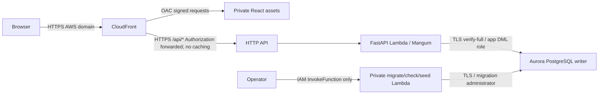

> **Existing deployment takes precedence:** CampusShift is already served from
> the Ohio EC2 endpoint. See [the current runbook](aws-deployment.md) and
> [verification report](aws-ec2-verification.md). This document preserves an
> alternative architecture and historical account observations, not authorization
> to provision or migrate. Current account identity is unverified on this workstation.

# Stage B: serverless deployment preparation

Prepared November 13, 2026. **Not deployed.** This is the current runbook for the
project-based AWS Free Plan, assigned Ohio home region `us-east-2`, named profile
`campusshift`. It supersedes the earlier us-east-1/IAM-user prerequisites. Keep
the AWS-managed project human role, account plan and managed policies unchanged.
No CDK dependency or bootstrap exists.

## Recommendation and eligibility

Use Lambda/Aurora for this intermittent university demonstration. Keep the
EC2/RDS templates and [fallback runbook](aws-deployment.md) for sustained use.
Neither Paid Plan nor Advanced Features is required by the proposed services.
The Free Plan service allowlist includes Lambda, API Gateway, RDS, EC2 networking,
S3, CloudFront, Secrets Manager, CloudWatch and CloudFormation; ordinary execution
roles can be created outside the protected `/managed/` path. That allowlist does
not itself grant create permissions or guarantee capacity.

Read-only evidence in this account: Ohio EC2/RDS/SSM/CloudFormation checks,
Lambda/HTTP API listing, Secrets Manager metadata listing, and live template
validation succeeded. Aurora PostgreSQL **16.15** reports serverless minimum
capacity **0**, so the template uses it. Lambda regional concurrency is **10**.
The last plan read showed ACTIVE FREE and **$100** remaining, expiring
`2027-05-13T00:36:01.583Z`. Recheck before execution. No resource-creation tests or
change sets were made; exact create permissions and service-linked role creation
remain deployment-time checks. Do not attempt a plan or policy change if denied.

Sources: [managed project policies](https://docs.aws.amazon.com/accounts/latest/reference/scps-and-rcps-for-projects.html),
[assigned regions](https://docs.aws.amazon.com/accounts/latest/reference/project-regions.html),
[zero-ACU operation](https://docs.aws.amazon.com/AmazonRDS/latest/AuroraUserGuide/aurora-serverless-v2-auto-pause.html).
See [the earlier read-only investigation](aws-project-free-plan-decision.md) for
the exact original denied actions and successful Ohio comparisons.

## Request path and exact proposed resources



| Template | Resources after approval |
| --- | --- |
| `infrastructure/serverless-artifacts.json` | One private encrypted, versioned artifact S3 bucket and TLS-only bucket policy |
| `infrastructure/serverless.json` | One VPC, two private subnets in different AZs, one local-only route table and two associations, two security groups and two PostgreSQL rules; one DB subnet group and one cluster parameter group; one Aurora cluster and **one** serverless writer; three generated secrets; two Lambda execution roles and two functions; three seven-day CloudWatch log groups; one HTTP API, Lambda proxy integration, `$default` route/stage, and one API invocation permission |
| `infrastructure/frontend.json` | One private encrypted/versioned assets S3 bucket and policy; CloudFront OAC, distribution, SPA routing function and security response-headers policy |

There are no NAT Gateways, internet gateways, public IPv4 addresses, VPC paid
endpoints, load balancers, RDS Proxy, extra reader instances, provisioned Lambda
concurrency, purchased domains or customer-managed KMS keys. Aurora's managed
storage replication remains; a single writer provides no hot reader failover.
The writer and Lambdas are private. Only TCP 5432 from the function security
group reaches PostgreSQL. Security groups suppress default unrestricted egress;
the loopback-only placeholder rule is not an internet route.

The frontend uses `https://<distribution>.cloudfront.net`. CloudFront routes API
requests to `https://<api-id>.execute-api.us-east-2.amazonaws.com`, forwards the
bearer `Authorization` header/query strings, replaces Host for origin TLS, and
disables API caching. Keep `VITE_API_BASE_URL` empty for same-origin production.
Production CORS is empty because browser requests go through CloudFront. No ACM
certificate purchase, DNS ownership, Function URL or SigV4 application login is
needed. The HTTP API is public, with existing JWT, ownership and role checks in
FastAPI; registration/login stay intentionally public. The private job Lambda
has no URL, route or API Gateway invocation grant. Direct API access remains
possible with valid application credentials; CORS is not an authorization layer.

## IAM and secrets

The two new execution roles trust `lambda.amazonaws.com`. Each may create log
streams/write events **only in its own function log group** and has the documented
Lambda VPC ENI permissions: Create/Delete/DescribeNetworkInterfaces,
Assign/UnassignPrivateIpAddresses and DescribeSubnets. ENI actions require `*`
in the standard execution policy. A `lambda:SourceFunctionArn` condition denies
ENI mutation originating in application code while allowing the Lambda service
to manage networking. No application administrative managed policy is created.
No EC2 instance profile, human IAM user or manual role setup is required.

The existing project human identity executes reviewed CloudFormation change sets
with `CAPABILITY_IAM` and passes only these Lambda execution roles to Lambda.
CloudFormation uses the caller's permissions; no extra deployment service role is
created. Required deployment operations cover these templates' EC2 VPC,
RDS cluster/writer, Lambda, API Gateway, IAM role/inline-policy/pass-role, S3,
CloudFront, Secrets Manager and log-group resources. The first RDS use can require
`iam:CreateServiceLinkedRole` for `rds.amazonaws.com`; API Gateway logging can
require CloudWatch Logs delivery/resource-policy operations. Package publication
needs object upload on the artifact/assets buckets and CloudFront invalidation;
private jobs need InvokeFunction on the **jobs** function. These are operation
requirements for the existing project login, not instructions to attach another
AdministratorAccess policy. Review actual failures before proposing any changes.

CloudFormation generates three Secrets Manager secrets: DB administrator, DB
application login and JWT signing key. Dynamic references resolve them at
deployment into Lambda's AWS-managed-key encrypted environment configuration.
Functions do **not** fetch secrets or call AWS APIs at runtime, so they need no
Secrets Manager/SSM/KMS retrieval permission and no NAT or interface endpoint.
The deploy caller requires `secretsmanager:GetSecretValue` for dynamic references.
The API receives only the app DB password/JWT key; jobs also receive the migration
DB credential. Passwords stay out of DATABASE_URL: a private 0700 `/tmp` directory
contains a 0600 escaped libpq passfile. `/tmp` is never application data storage.
RDS certificate verification uses the Ohio CA bundle packaged from AWS's TLS
trust store. Rebuild before CA/runtime dependency updates.

**Tradeoff:** principals authorized to read Lambda configuration can read these
resolved secrets. Do not print function environments, secret values, job payloads
or AWS debug logs. Dynamic references don't automatically refresh after a secret
changes. Automatic rotation is disabled. Future rotation needs its own reviewed
maintenance procedure to update PostgreSQL credentials, affected function
configuration (`SecretConfigRevision` forces a refresh), and any admin cluster
credential. The migrate job deliberately never resets an existing app password.
See [dynamic reference behavior](https://docs.aws.amazon.com/AWSCloudFormation/latest/UserGuide/dynamic-references-secretsmanager.html).

## Connection lifecycle, latency and migrations

API: Python 3.12/x86_64, 1024 MiB, timeout 28 seconds; HTTP integration 29 seconds;
browser timeout 35 seconds. Mangum's cached adapter disables ASGI lifespan per
invocation; there is no cold-start migration, seed or DB probe. Each request owns
and closes its SQLAlchemy session. `NullPool` closes physical connections on
return, including warm invocations. Existing PostgreSQL advisory transaction
locking, optimistic schedule versions, unique constraints, rollback and
server-clock attendance rules remain unchanged. Local SQLite remains the default
for development; production requires PostgreSQL, not DynamoDB.

Connection setup retries at most twice, each with a 10-second libpq timeout and
one-second backoff; authentication/certificate/configuration errors fail without
retry. Only connection establishment is retried. Statements, transactions and
browser writes are never automatically replayed. API statement timeout is 5
seconds and lock timeout 2 seconds; jobs use 60 seconds and 10 seconds. Database
errors produce a generic 503; unexpected errors produce a generic 500. Logs
exclude tokens, request bodies, query strings and exception text/tracebacks.

Aurora usually resumes in about 15 seconds, but longer resumes/cold starts or
large scheduling workloads may exceed the HTTP deadline. A failed write response
is ambiguous: inspect refreshed state before retrying. Use `/api/ready` once to
wake/check the DB before a presentation; this is a billed DB operation. The
pure `/api/health` endpoint does not open DB connections. Local timings do not
establish deployed latency or performance at 1024 MiB/1 ACU.

Min/max capacity is **0/1 ACU**, pause interval **300 seconds**, with one-day
automated backup retention, forced TLS, storage encryption and deletion
protection. Max ACU is a compute limit, not a budget cap. Open pooled connections,
RDS Proxy, SQL consoles, repeated readiness probes, scheduled warmers or the
existing 30-second attendance UI polling can keep Aurora awake. Close browser
tabs/SQL clients before pause tests. AWS maintenance/features may delay pause;
measure actual ACU and connection metrics. Min=0.5 requires a separate cost review.

The default API reservation parameter **0 means omit the reservation**, not set
Lambda reserved concurrency to zero. AWS normally keeps 100 unreserved capacity,
so a regional quota of 10 cannot support the proposed small reservation. HTTP API
throttles to 1 request/second, burst 2; throttling is best effort and may yield
429 during initial page loading. It is not per-function concurrency isolation.
The shared regional quota bounds total running functions; run jobs without user
traffic. No quota increase is requested. [AWS concurrency rules](https://docs.aws.amazon.com/lambda/latest/dg/configuration-concurrency.html).

The separate 120-second private job invokes `alembic upgrade head`, checks drift,
then creates a non-admin application SQL role with table DML, sequence usage and
schema usage. The app cannot create tables/roles or edit Alembic's revision.
Subsequent migrations regrant access for new tables without resetting passwords.
A separate session advisory lock serializes deployment jobs; it is released on
exit/disconnect. Only explicit actions `migrate`, `check`, `seed` are accepted.
`seed` privately prompts for a synthetic password and requires a separate demo
approval flag; it creates fictional accounts and a completed prior-week schedule
with attendance and can be repeated without duplicate records. See
`backend/app/seed_cloud_demo.py` for fictional login emails.

Future incompatible schema changes require a maintenance window: the job lock
does not pause live API writes. Do not downgrade a live schema as an automatic
rollback. Take/verify a backup first and roll back compatible code or review a
forward migration. Existing EC2 backup scripts remain available for a host with
private DB access; the workstation cannot directly access this private cluster.
Snapshot restore creates billable infrastructure and needs separate approval.

## Ohio costs before credits

Full assumptions and rates: [`cost-plan.us-east-2.json`](../infrastructure/cost-plan.us-east-2.json).
No legacy 750-hour RDS/EC2 allowances or promotional discounts are assumed.

| Small demo month: 60 active hours including idle tails | USD/month |
| --- | ---: |
| Aurora compute at average 0.5 ACU × $0.12/ACU-hour | 3.60 |
| 10 GB starting storage budget + 1 million I/Os | 1.20 |
| Three Secrets Manager secrets | 1.20 |
| 10,000 one-second/1 GB API calls + ten 30-second jobs | 0.174 |
| HTTP API for 10,000 small requests | 0.01 |
| 0.1 GB logs ingested + retained storage allowance | 0.053 |
| 1 GB S3 assets/artifacts and small request allowance | 0.073 |
| CloudFront: 1 GB North America transfer, 20,000 HTTPS requests, 10,000 function calls | 0.106 |
| Cross-AZ/Secrets Manager API allowance | 0.10 |
| Backups within included active-DB allowance | 0 |
| Native CloudFormation, IAM, VPC/subnets/security groups; fixed network charges | 0 |
| **Calculated total** | **6.52** |

Budget **$7–12/month** for that use. At average 1 ACU over those 60 hours, the
calculated total is about **$10.12**. Continuously active at average 0.5 ACU costs
**$43.80 compute / ~$46.72 total**; at 1 ACU **$87.60 compute / ~$90.52 total**
using the same small non-compute usage. The largely paused floor is about **$2.20**
for storage/secrets plus retained assets/logs/I/O. There is no always-on EC2
compute, but storage, secret retention, object versions and backup overages remain
billable while Aurora is paused.

Aurora storage grows from 10 GiB; actual billed units, I/O and usage determine
the invoice. Automated backup storage up to the live database allowance is
included; excess/manual retained backups are approximately $0.021/GB-month.
CloudWatch retains seven days; ingestion, queries and retained storage cost
money. Cross-AZ traffic, S3 versions, extra snapshots, longer Lambda cold starts,
IPv4 added later, and large/public traffic are additional usage. No billing alarm
or kill switch is provisioned. Review AWS Settings credit/usage notifications and
approve any budget alerts separately; retain at least $20 in credits as reserve.

The existing Ohio t3.micro + db.t3.micro RDS fallback has a **$27.64/month fixed
baseline**, approximately **$30–35/month** including low traffic. At this model's
0.5 active ACU, serverless reaches that baseline at roughly **412 active DB
hours/month**; at 1 ACU roughly **206 hours**. These are cost comparisons, not
performance equivalence. Continuous UI polling removes the expected serverless
saving. EC2/RDS also needs origin HTTPS configuration/maintenance; the API Gateway
AWS domain avoids that prerequisite here.

Price sources: [Aurora](https://aws.amazon.com/rds/aurora/pricing/),
[Ohio public RDS price file](https://pricing.us-east-1.amazonaws.com/offers/v1.0/aws/AmazonRDS/current/us-east-2/index.json),
[Secrets Manager](https://aws.amazon.com/secrets-manager/pricing/),
[Lambda](https://aws.amazon.com/lambda/pricing/),
[HTTP API](https://aws.amazon.com/api-gateway/pricing/),
[CloudFront](https://aws.amazon.com/cloudfront/pricing/pay-as-you-go/),
[CloudWatch](https://aws.amazon.com/cloudwatch/pricing/),
[S3](https://aws.amazon.com/s3/pricing/).

**Retention risk:** templates retain the DB writer/cluster, their network
dependencies, secrets, log groups and S3 buckets on deletion/replacement. Deleting
a stack does not stop their charges. DB deletion protection is enabled. Removing
retained resources, disabling protection, deleting object versions or restoring
backups always needs a separate explicit plan/approval; helpers do not delete.
Keep stack ownership intact. A partial initial deployment can leave retained
objects with conflicting names; inspect events and inventory before retrying.

## Commands after explicit provisioning approval only

Run PowerShell at the repo root with Python venv, Docker Desktop, Node 22.13+,
npm and AWS CLI available on PATH. Browser login may be refreshed as needed.
`plan`, `preflight`, `validate`, `outputs` and `parameters` do not create resources;
packaging only builds locally. Commands marked approval below have **not run**.

```powershell
$py = '.\backend\.venv\Scripts\python.exe'
aws login --profile campusshift --region us-east-2
aws sts get-caller-identity --profile campusshift --region us-east-2
& $py scripts/aws_deploy.py plan
& $py scripts/aws_deploy.py preflight
& $py scripts/aws_deploy.py package-lambda
& $py scripts/verify_lambda_package.py
& $py scripts/aws_deploy.py validate serverless-artifacts
& $py scripts/aws_deploy.py validate serverless
& $py scripts/aws_deploy.py validate frontend
# Compare this account number with AWS Settings before authorizing mutations:
$accountId = (aws sts get-caller-identity --profile campusshift --region us-east-2 --query Account --output text).Trim()

# Approval required. Each create-change-set prints a distinct review-<timestamp>.
& $py scripts/aws_deploy.py change-set serverless-artifacts campusshift-artifacts infrastructure/serverless-artifacts.parameters.example.json --expected-account $accountId --approve-costs
aws cloudformation wait change-set-create-complete --stack-name campusshift-artifacts --change-set-name REVIEW_NAME --profile campusshift --region us-east-2
aws cloudformation describe-change-set --stack-name campusshift-artifacts --change-set-name REVIEW_NAME --profile campusshift --region us-east-2
# Replace REVIEW_NAME with that command's actual reviewed name:
& $py scripts/aws_deploy.py execute campusshift-artifacts REVIEW_NAME --expected-account $accountId --approve-costs
aws cloudformation wait stack-create-complete --stack-name campusshift-artifacts --profile campusshift --region us-east-2
& $py scripts/aws_deploy.py upload-backend campusshift-artifacts --expected-account $accountId --approve-costs
& $py scripts/aws_deploy.py parameters serverless campusshift-artifacts
& $py scripts/aws_deploy.py change-set serverless campusshift-api .local/serverless/serverless.parameters.json --expected-account $accountId --approve-costs
# Wait and describe/review the NEW change set as above before executing it.
& $py scripts/aws_deploy.py execute campusshift-api REVIEW_NAME --expected-account $accountId --approve-costs
aws cloudformation wait stack-create-complete --stack-name campusshift-api --profile campusshift --region us-east-2
& $py scripts/aws_deploy.py job campusshift-api migrate --expected-account $accountId --approve-costs
& $py scripts/aws_deploy.py job campusshift-api check --expected-account $accountId --approve-costs
& $py scripts/aws_deploy.py job campusshift-api seed --approve-demo-data --expected-account $accountId --approve-costs
& $py scripts/aws_deploy.py parameters frontend campusshift-api
& $py scripts/aws_deploy.py change-set frontend campusshift-web .local/serverless/frontend.parameters.json --expected-account $accountId --approve-costs
# Wait and describe/review this NEW change set, then:
& $py scripts/aws_deploy.py execute campusshift-web REVIEW_NAME --expected-account $accountId --approve-costs
aws cloudformation wait stack-create-complete --stack-name campusshift-web --profile campusshift --region us-east-2
& $py scripts/aws_deploy.py upload-frontend campusshift-web --expected-account $accountId --approve-costs
& $py scripts/aws_deploy.py outputs campusshift-web
```

Do not paste secret values into commands. Job seed uses a private temporary input
file removed afterward, privately prompts for a password, and disables CLI
invocation retries to avoid replaying writes. Generated parameter files contain
only bucket/key/domain values in ignored `.local/serverless/`. Published backend
objects have a SHA-256 content key and are hash-verified before upload. CloudFront
assets upload first, index last, without deleting prior hashed assets. On updates,
build/upload a new ZIP, refresh parameters, use `change-set ... --type UPDATE`,
review, execute, wait `stack-update-complete`, then run reviewed migration/check
jobs in a maintenance window. The helper rejects Remove/Replace change sets.

## Verification and remaining cloud tests

Local results and commands are recorded in [verification](verification.md).
Local ASGI and real Mangum HTTP-v2 contracts cover auth/roles/ownership,
availability/classes, scheduling/publication, leave and server-clock attendance,
CSV and transactional errors. PostgreSQL tests cover migrations, repeatable seed,
restricted application-role DDL denial, null-pool connection closure and
concurrent writes. Packaging is checked in an isolated Linux Lambda image with
no network. Frontend lint/build and CloudFormation lint/live validation run.

After deployment approval, test with **synthetic data only**:

1. Confirm private S3 access is denied, CloudFront deep-link reload works over
   HTTPS, no browser mixed content, Authorization reaches FastAPI, and API
   responses/CSV have no CloudFront cache hits. Verify expected role landing pages.
2. Register a student, log in, test bad/expired JWT and forbidden supervisor APIs;
   confirm registration cannot request supervisor privileges. Sign in to the
   separately seeded supervisor. Confirm cross-department IDs return 404/403.
3. Add classes and availability, reject overlaps; configure locations, eligibility
   and staffing. Generate a realistic schedule and record Lambda duration/memory
   and DB ACU/latency at the configured 1024 MiB/1 ACU limits.
4. Edit using expected versions, race two edits, verify one conflict; publish,
   verify student visibility and stale publish rejection. Request/approve/reject
   time off, regenerate and verify approved leave exclusion and audit history.
5. Publish a shift near current **server** time; clock in/out, reject forged times
   and duplicate/concurrent clock-ins, verify weekly actual hours and supervisor
   CSV. Seeded attendance is from a past week and cannot be used to clock in now.
   Do not change the deployed server clock to make tests pass.
6. Submit/review a correction, verify original timestamps remain, department
   ownership and CSV formula protection. Confirm errors do not expose secrets.
7. Reload/re-login and invoke a fresh/cold function environment after a reviewed
   code update. Confirm users, published shifts and attendance persist in Aurora.
   Run the private check job; ensure the public HTTP API cannot invoke jobs.
8. Close all dashboard tabs/DB consoles, stop readiness checks and wait beyond
   300 seconds. Observe DB `ServerlessDatabaseCapacity`/events reaching zero and
   no user connections. Use health once; confirm it does not wake Aurora. Resume
   with readiness/login, measure first-request latency and connection retries,
   then confirm later requests succeed. Test longer resume and transient failure
   without automatic write replay. Verify no warm idle connections remain.
9. Check regional concurrency/throttles at modest approved load, API 429 behavior,
   query/lock timeouts and rollback. Do not conduct an unapproved load/billing
   stress test. Compare actual ACU-hours, I/O, storage, logs and credits with this
   estimate; check after one day and one week and stop for review if it drifts.
10. Review a backup/restore drill separately: new private restored resources cost
    money and must be approved. No destructive cleanup or snapshot restore is
    part of these preparation commands.

**Outstanding:** AWS provisioning approval, real create/capacity checks and the
cloud tests above. Public abuse resilience, higher concurrency and larger campus
loads are outside this small demo envelope. SNS notifications remain a separate
unimplemented feature; they are not needed by the current app execution path.
